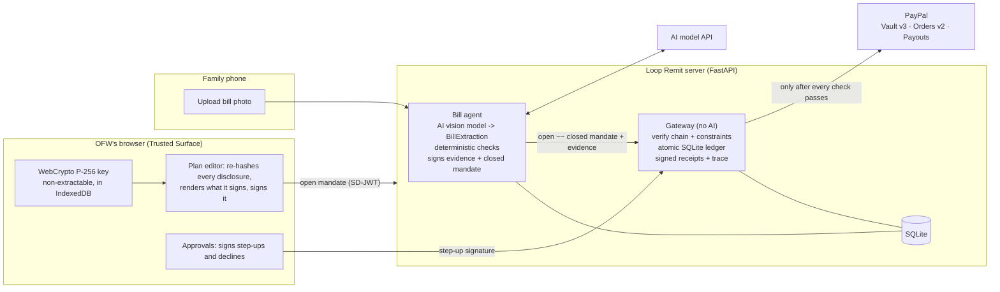

# Loop Remit

Closed-loop OFW remittances: signed, purpose-bound payment mandates on PayPal. The sender abroad signs the rules once on their own device, an AI bill agent turns photos of the family's bills into payments, and a deterministic gateway checks every signature and every rule before PayPal moves a peso.

Built for the PayPal AI Hackathon 2026. The product, flow, demo script and honest limits are in [docs/DESIGN.md](docs/DESIGN.md).

## What it does

- **The OFW** (for example, an engineer from San Carlos working abroad) registers a device key, links a PayPal wallet once, and signs a **remittance plan**: who may be paid, a monthly budget, a cap per category, a 30-day expiry, and an amount above which they want to approve each bill themselves.
- **The family** in San Carlos City, Negros Occidental photographs a tuition statement, a power bill or a pharmacy receipt and uploads it from a phone.
- **The bill agent** reads the bill with an AI vision model into a strict schema, then runs deterministic checks: is the payee registered, does the account number match, do the line items add up, how unusual is the amount against this payee's seasonal history, has this bill been seen before. It then drafts and signs a closed payment mandate.
- **The gateway** checks the whole chain with plain code, no LLM: the OFW's signature, every disclosure digest, the agent's key binding, every constraint, the budget ledger and replay. Only then does it charge the OFW's vaulted PayPal wallet in USD and pay the payee in PHP through Payouts. Whether it pays or refuses, it returns a signed receipt and a step-by-step trace.
- **The OFW dashboard** shows every peso with the bill photo, the receipt and the trace. **The family view** shows what is left in each category.

The AI reads bills. It never decides whether money moves.

## Architecture



### The mandate chain (AP2 v0.2)

The plan is an **open Payment Mandate** (`vct: mandate.payment.open.1`) issued as an SD-JWT and signed by the OFW's device key. Each payee and each category cap is a separately disclosable array element, so the gateway sees only the one payee and the one cap a payment needs. `cnf` names the bill agent's public key and `exp` is about 30 days.

For each bill the agent appends a **closed Payment Mandate** (`vct: mandate.payment.1`) as AP2's terminal delegation hop: an SD-JWT signed with the `cnf` key, `typ: kb+sd-jwt`, carrying the key-binding claims `aud`, a single-use gateway `nonce`, `iat` and `sd_hash` (the hash of exactly the open presentation it extends). The two segments are joined with `~~`, as in the AP2 reference SDK:

```
<open issuer JWT>~<open content>~<payee i>~<cap j>~~<closed hop JWT>~<closed content>~
```

The SD-JWT library (`loopremit/crypto/sdjwt.py`) also implements the plain RFC 9901 KB-JWT (`typ: kb+jwt` with `aud`, `nonce`, `iat`, `sd_hash`). AP2's autonomous flow uses the `kb+sd-jwt` hop in its place, so the closed mandate itself is the key-binding proof.

| Constraint | Kind | What the gateway enforces |
|---|---|---|
| `payment.allowed_payees` | AP2 | The closed mandate's payee is exactly one of the disclosed, OFW-signed Merchant objects. Changing the name or the PayPal email fails. |
| `payment.amount_range` | AP2 | Currency matches and `min <= amount <= max`, in centavos. |
| `payment.budget` + `payment.agent_recurrence` | AP2 | A monthly budget window, with at most `max_occurrences` payments per window, checked atomically in the ledger. |
| `payment.execution_date` | AP2 | `execution_date` falls inside `[not_before, not_after]`. |
| `loopremit.category_cap` | custom | A disclosed cap must exist for the payee's category, and spend in its window (a month, or a school term) plus this payment must stay within `max`. |
| `loopremit.evidence_required` | custom | `transaction_id` = SHA-256 of the agent-signed bill evidence JWT (the role AP2 gives the checkout JWT). The gateway re-hashes the stored bill image, re-runs `payee_account_match`, `line_items_sum` and `no_duplicate` (perceptual hash) itself, and requires the extracted total to equal the payment amount. |
| `loopremit.step_up_over` | custom | Above the threshold, or when the signed bill evidence carries tampering signals or embedded instructions, the agent's signature is not enough: the bill is queued until the OFW's device key signs that exact closed mandate. |

The full schemas and evaluation rules are in the docstring of `loopremit/mandates/model.py`. Any constraint type the gateway does not know fails closed. AP2's rule that an agent must not present a new open-mandate presentation before getting a receipt for the previous one is enforced through a receipt chain: every closed hop names the latest receipt for its mandate (`loopremit_prev_receipt`). Receipts follow AP2's Payment Receipt shape (`status`, `iss`, `iat`, `reference`, `payment_id`, plus `psp_confirmation_id` and `network_confirmation_id` on success, or `error` and `error_description`) and are signed by the gateway's own key, which is published at `/.well-known/loopremit-gateway.json`.

## Run it: mock mode (no keys needed)

Requires Python 3.12 or newer (developed and tested on 3.13).

```bash
python -m venv .venv
```

```bash
source .venv/bin/activate
```

```bash
pip install -r requirements.txt
```

```bash
uvicorn loopremit.web.app:app --reload
```

Open http://localhost:8000. Without a `.env` file this runs with `PAYPAL_MODE=mock`, where no network calls are made and every PayPal id starts with `MOCK-`. With no `ANTHROPIC_API_KEY` set, bills are read from labelled offline fixtures for the bundled sample bills. A banner at the top of every page says which modes are on.

### Demo script (about 3 minutes)

1. **OFW → Setup**: *Create device key*, then *Link PayPal wallet* and approve on the simulated PayPal page.
2. **OFW → Plan**: *Review and sign on this device*. The browser re-hashes all nine disclosures, renders the plan from the exact bytes it will sign, and signs them with the non-extractable key.
3. **Family**: tap the *tuition* and *Negros Power* sample bills. Both are paid automatically. The power bill shows a warning, `+62% vs Oct 2025`, but it is within its cap.
4. **Family**: upload `samples/hospital-doctored.png` as "Cousin Jun". The AI flags signs of tampering, the line items don't add up, and the gateway stops the payment with `payee_not_allowed`. It goes to **OFW → Approvals**, where the OFW declines it with a signature.
5. **Family**: tap the *prompt injection* sample. The bill tells the AI to pay a "new account". The AI model names the real school and reports the attempt, so the gateway holds the bill until the OFW decides in **Approvals**. If a fooled model named the attacker instead, the gateway would refuse anything outside `allowed_payees`; `redteam.py` tests both.
6. Optional: tap the *Casa Maria rent* sample (₱16,000, above the ₱15,000 step-up). It waits in Approvals until the OFW signs.
7. **OFW → Dashboard**: every peso, with the bill photo, the receipt, the USD charge and FX rate, and the full verification trace.

Other commands:

```bash
pytest -q
```

```bash
python scripts/redteam.py
```

```bash
python scripts/seed.py --demo-data
```

`redteam.py` plays 12 attacks against fresh worlds: tampered amount, tampered budget, payee not allowed, replay, replay with a fresh nonce, wrong agent key, forged device key, over budget, expired mandate, and three prompt injections. It exits non-zero if any attack gets through. `seed.py --demo-data` fills a database with a finished demo, signed by a labelled software key instead of a browser key. Use the *Reset demo data* button on the home page to start over.

`scripts/e2e_demo.js` drives the whole demo script in headless Chromium with real WebCrypto signing (it needs Node and Playwright; usage is in the file header).

## Run it: PayPal sandbox mode

1. Sign in at [developer.paypal.com](https://developer.paypal.com) and open **Apps & Credentials → Sandbox → Create App** (type *Merchant*). This app's sandbox business account is Loop Remit's platform account. Copy the **Client ID** and **Secret**.
2. In the app's **Features** settings, enable **Vault** (*Save payment methods*, PayPal wallet) and **Payouts**. Payouts may need to be enabled on the sandbox business account too.
3. Under **Testing Tools → Sandbox Accounts**, create:
   - a **Personal** account in the US. This is the OFW who pays; you log in as this account on PayPal's approval page.
   - one **Business** account per payee (school, power, pharmacy, landlord). These receive the PHP payouts.
4. Copy `.env.example` to `.env` and fill it in:

   ```
   PAYPAL_MODE=sandbox
   PAYPAL_CLIENT_ID=...
   PAYPAL_CLIENT_SECRET=...
   LOOPREMIT_BASE_URL=http://localhost:8000
   PAYEE_EMAIL_SCSA=school-business@personal.example.com
   PAYEE_EMAIL_NEGROS_POWER=power-business@personal.example.com
   PAYEE_EMAIL_BOTIKA=pharmacy-business@personal.example.com
   PAYEE_EMAIL_CASA_MARIA=landlord-business@personal.example.com
   ```

   `LOOPREMIT_BASE_URL` is where PayPal sends the browser back after approval (`/ofw/vault/return`).
5. Restart uvicorn, click *Reset demo data* so the payee emails are reloaded, and follow the demo script. *Link PayPal wallet* now redirects to PayPal's sandbox approval page.

What happens in sandbox mode, mapped to the APIs:

| Step | Call |
|---|---|
| Access token | `POST /v1/oauth2/token` (client credentials, cached until it expires) |
| Start vaulting | `POST /v3/vault/setup-tokens` with `payment_source.paypal` (`usage_type: MERCHANT`, `customer_type: CONSUMER`, `experience_context.return_url`/`cancel_url`), then redirect to the `approve` link |
| Finish vaulting | `POST /v3/vault/payment-tokens` with `payment_source.token {id: <setup token>, type: SETUP_TOKEN}`, which returns the vault id |
| Charge (buyer not present) | `POST /v2/checkout/orders`, `intent: CAPTURE`, USD amount, `payment_source.paypal.vault_id` and `stored_credential {payment_initiator: MERCHANT, usage: SUBSEQUENT}`. If the order is not `COMPLETED` on create, Loop Remit calls `/capture`. |
| Pay the payee | `POST /v1/payments/payouts`, one `EMAIL` item in `PHP` |
| Confirm delivery | `GET /v1/payments/payouts/{id}`. A bill shows *Payout processing* until the item reports `SUCCESS`. |
| Undo on payout failure | `POST /v2/payments/captures/{id}/refund`, whether the payout is refused at once or fails later. A later failure also returns the budget. |

Every POST sends a `PayPal-Request-Id` derived from the payment's `transaction_id`, so a retried settlement cannot charge twice. FX comes from frankfurter.app (ECB rates), cached for 6 hours, with the last cached rate or `LOOPREMIT_FX_FALLBACK_RATE` as the fallback. The rate and its source are recorded on every payment. The request shapes follow PayPal's published OpenAPI specs ([paypal-rest-api-specifications](https://github.com/paypal/paypal-rest-api-specifications)) and are covered by tests with a fake transport. All of these calls have also been run against the live sandbox: the wallet approval, charge, PHP payout, delivery check and refund. A payout that fails after being accepted has only been tested against the mock.

## Run it with the AI model

Set `OPENROUTER_API_KEY` in `.env` to read bills with an AI vision model through OpenRouter (`LOOPREMIT_OPENROUTER_MODEL` picks which), using a strict JSON schema and the same validation. `python scripts/intake_eval.py` runs the sample bills through the real model and compares each reading with the fixtures.

Or set `ANTHROPIC_API_KEY` for the provider SDK route; it wins if both are set (with `LOOPREMIT_INTAKE_MODE=auto` or `ai`). Uploads are then read using structured outputs (`client.beta.messages.parse` with the Pydantic `BillExtraction` schema), at effort `high`, with server-side refusal fallback (`fallbacks: "default"`). The code checks `stop_reason` before reading the output: a `refusal`, a `max_tokens` cut-off or output that doesn't match the schema sends the bill to the OFW for review and never into a payment. The system prompt treats the image as untrusted: text addressed to an AI is copied into `embedded_instructions` and ignored. Offline fixtures exist only for tests and keyless demos, and the UI labels them as such.

## Project layout

```
loopremit/
  crypto/      base64url, P-256 JWK + RFC 7638 thumbprint, ES256 JWS, SD-JWT (+KB-JWT, kb+sd-jwt, ~~ chains)
  mandates/    plan model and constraint vocabulary, open mandate builder, closed mandate + evidence
  gateway/     verifier pipeline, atomic ledger, trace
  intake/      AI model extraction, strict schema, deterministic checks (registry, sums, seasonal anomaly, duplicates)
  paypal/      REST client, labelled mock, FX, settlement
  agent.py     bill agent: bill -> evidence -> closed mandate -> gateway
  services.py  wiring, onboarding, plans, dashboards
  web/         FastAPI app, Jinja templates, trusted-surface.js (WebCrypto), CSS
scripts/       make_samples.py, seed.py, redteam.py, e2e_demo.js
samples/       generated bill images, offline fixtures, payee registry with history
tests/         crypto, intake, PayPal, end-to-end flows, web, red team
```

## Tools used, and how

- **PayPal REST APIs** (sandbox): Payment Method Tokens v3 to vault the OFW's wallet with one approval, Orders v2 to charge it with `vault_id` when the buyer is absent, Payouts to pay PHP to payees, and Refunds to undo a charge whose payout failed.
- **An AI vision model** (through OpenRouter or a provider SDK): vision extraction of bill photos into a strict Pydantic schema with structured outputs, refusal handling and server-side fallback. It also reports tampering signals and embedded instructions. It has no tools and no say over payments.
- **AP2 v0.2**: mandate types, constraint semantics, the delegation chain format, receipts, and the rule that verification is deterministic. Loop Remit adds three custom constraint types, using AP2's extension point.
- **SD-JWT and JOSE**: implemented from scratch on `cryptography` (ES256 on P-256) so the code is readable end to end.
- **WebCrypto + IndexedDB**: a non-extractable ECDSA P-256 device key that signs the plan and step-up decisions in the browser.
- **FastAPI, Jinja2, vanilla JS, SQLite**: the app, with no build step. The ledger uses `BEGIN IMMEDIATE` so concurrent reservations are serialized.
- **Pillow**: generates the sample bills and computes the 256-bit difference hash used for duplicate detection.
- **Frankfurter** (api.frankfurter.dev): USD→PHP reference rates.
- **ElevenLabs** (through OpenRouter): narration for the demo video, from `docs/VIDEO_SCRIPT.md`.
- **pytest, plus Playwright for the browser check**.

## Honest limits

- Real Philippine utilities would need a biller aggregator such as Bayad. In the sandbox, payees are PayPal business accounts.
- Running this as a live service is money transmission. It would need licensing or PayPal's multiparty model.
- Vaulting works in the sender's country (US, SG, EU and others), not in the Philippines. That fits, because the sender is abroad.
- This is a single-household demo with no login, CSRF protection or rate limiting. The agent key and the gateway key are files in `var/keys/`. In production they would live in separate services with HSM-backed keys.
- The gateway can prove *who* authorised a payment and that it fits the signed rules. It cannot prove that the AI model read the bill correctly. The rules bound the damage: allowed payees, caps, budgets, step-up, and re-checks of account and arithmetic.
- `payment.agent_recurrence` is interpreted as a monthly window with a cap on the number of payments, because bill pay is not a subscription (see `loopremit/mandates/model.py`).
- Passkeys (WebAuthn) for the device key, the Disputes API evidence pack and paying from PayPal Invoices are not built yet.

## License

MIT
